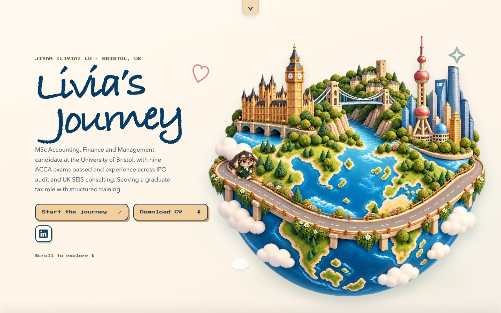
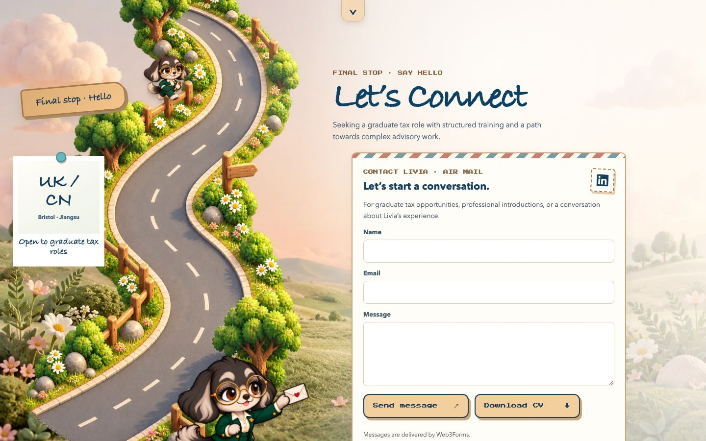
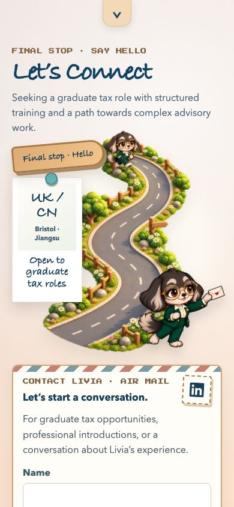

# Journey Portfolio

A one-page storytelling portfolio built with Svelte 5 and Vite. Rather than a conventional résumé layout, the content unfolds as a journey: a floating clay globe opens the page, a winding road links the chapters, and a small animated dog walks the road as you scroll. It ends at a contact card.



## What it showcases

- **Hero scene** — floating globe artwork with a profile summary and two calls to action.
- **Chapter navigation** — a compact slide-down menu linking to each stop, with active-section tracking, keyboard support, and `Escape` to close.
- **Story chapters** — Education, Work Experience, Skills & Strengths, and Beyond Work, each paired with an illustrated road scene and pinned Polaroid fact cards.
- **Timeline entries** — date-labelled cards with bullet detail, revealed on scroll.
- **Contact card** — CV download, LinkedIn link, and an accessible email form with validation, sending state, and a graceful fallback when no submission key is configured.
- **Responsive motion** — a continuous road on desktop, a shorter natural flow on mobile; animation respects `prefers-reduced-motion`.

## Stack

| Tool | Role |
| --- | --- |
| Svelte 5 | Components and runes-based state |
| Vite 6 | Dev server and static build |
| Playwright | End-to-end smoke tests, run in CI |
| Vercel | Static hosting |

No backend. The build output is plain HTML, CSS, JS, and images.

## Project structure

```
src/App.svelte      content and page structure
src/portfolio.css   layout, scenes, and styling
public/assets/      WebP illustrations and sprites (1.1 MB total)
public/cv/          downloadable PDF
public/og-image.jpg 1200×630 social preview card
tests/              Playwright specs
vercel.json         deployment and header configuration
```

## Notes

- The contact form posts to a third-party form service. Its access key is supplied through the environment (`VITE_WEB3FORMS_ACCESS_KEY`) and is never committed.
- Restrict that key to the production domain in the service dashboard before going live.
- Deployment settings live in `vercel.json`; Node 22 is pinned through `.nvmrc`.
- Shared links render a preview card from the `og:*` and `twitter:*` tags in `index.html`. Regenerate `public/og-image.jpg` from `docs/screenshots/desktop-home.jpg` if the hero changes.
- Artwork is WebP; regeneration should keep each file under ~400 KB.

## Screenshots

| Desktop | Mobile |
| --- | --- |
|  |  |
|  |  |
