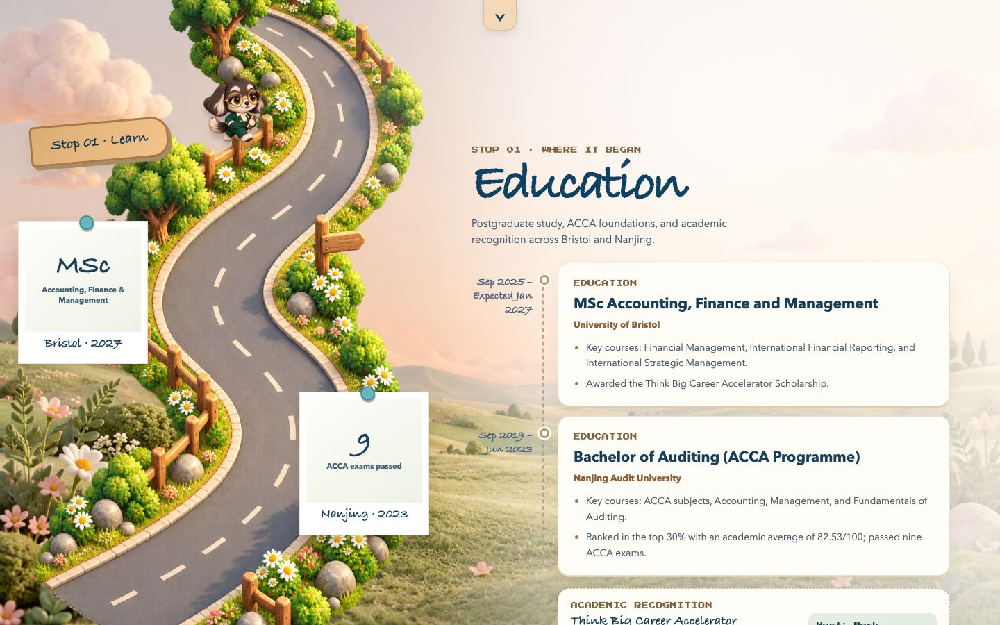
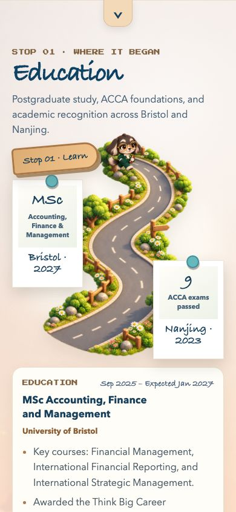

# Livia's Journey

A one-page portfolio for Jiyan (Livia) Lu, an MSc Accounting, Finance and Management candidate at the University of Bristol with nine ACCA exams passed and experience in IPO audit and UK SEIS consulting. She is seeking a graduate tax role.

The site is a single scrolling story rather than a conventional résumé: a floating clay globe opens the page, then a road unwinds through four chapters (Education, Work Experience, Skills & Strengths, Beyond Work) with Polaroids pinned along the way and a small dog walking the road as you scroll. It ends at a contact card with a CV download and an email form.


Built with Svelte 5 and Vite. Static, no backend, deploys to Vercel.

## Run

```bash
npm ci
npm run dev     # local server
npm test        # Playwright smoke tests
npm run build   # static output in dist/
```

## Content and configuration

- Portfolio copy lives near the top of `src/App.svelte`; layout and styling in `src/portfolio.css`.
- The contact form posts to Web3Forms. Set `VITE_WEB3FORMS_ACCESS_KEY` in `.env.local` locally and in the Vercel project for production. Without it, the form falls back to LinkedIn.
- Restrict the Web3Forms key to the production domain in their dashboard.
- Deployment details are in `vercel.json` and `.nvmrc` (Node 22).

## Screenshots

| Desktop | Mobile |
| --- | --- |
|  |  |
|  |  |
